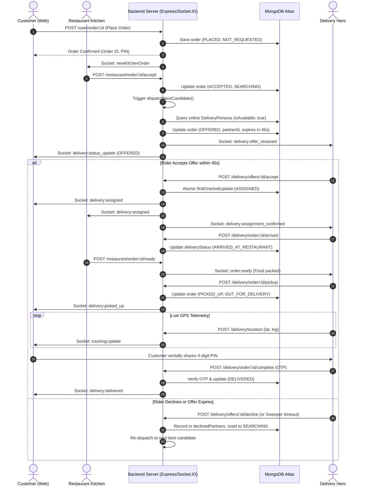
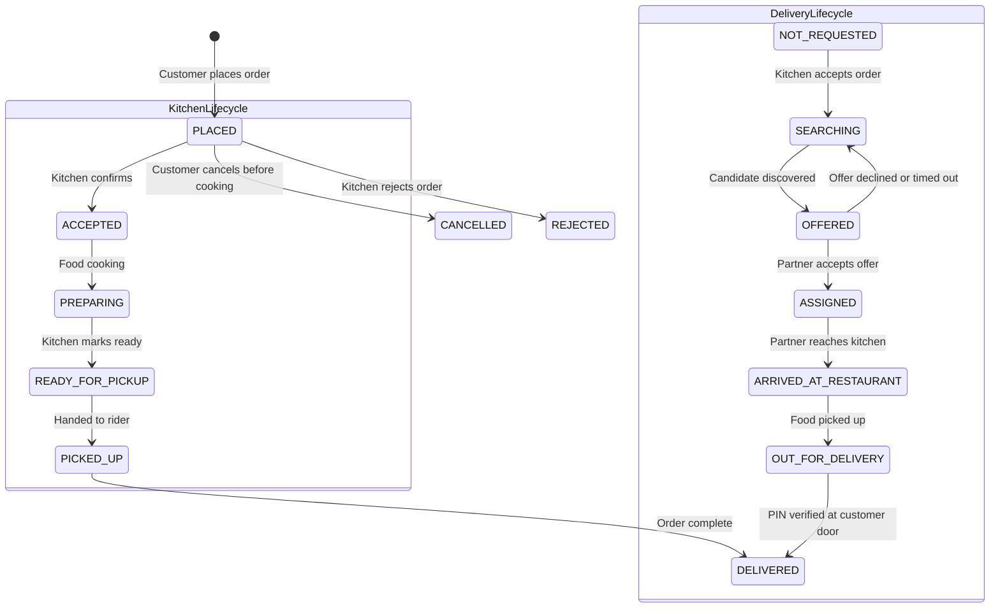

# CraveCart — End-to-End Order & Delivery Orchestration Workflow

## Overview

CraveCart implements an autonomous, decoupled food delivery lifecycle modeled after leading platforms such as Swiggy and Zomato. The architecture guarantees a strict separation of concerns:
- **Customers** own order placement, tracking, and delivery handover verification via a 4-digit PIN.
- **Restaurants** control food preparation (Accept, Cook, Pack, Mark Ready for Pickup).
- **Delivery Partners** own physical logistics (Offer review, Acceptance, Transit, Pickup, and Handover).
- **Dispatch Engine** orchestrates candidate discovery, proximity ranking, atomic assignment, and timeout recovery.

---

## Technical Step-by-Step Lifecycle

### Step 1: Customer Places Order
- **API**: `POST /user/order/:id`
- **Validation**: Cart items, active restaurant status, delivery address, subtotal, and payment verification.
- **Persistence**: Order record created with:
  - `orderStatus`: `"PLACED"`
  - `status`: `"Placed"`
  - `deliveryStatus`: `"NOT_REQUESTED"`
  - `deliverypersonid`: `null`
  - `deliveryOtp`: Generated 4-digit secure PIN.
- **Real-Time Notification**: Emits `newKitchenOrder` and `updatingRestOrder` to room `restaurant_${restaurantId}`.

### Step 2: Kitchen Reviews & Accepts Order
- **API**: `POST /restaurant/order/:id/accept`
- **State Transition**:
  - `orderStatus`: `"ACCEPTED"`
  - `status`: `"Preparing"`
  - `deliveryStatus`: `"SEARCHING"`
- **Dispatch Trigger**: Triggers `dispatchNextCandidate(order._id, req.io)`.

### Step 3: Candidate Discovery & Ranking
- **Function**: `rankEligibleDeliveryPartners(order)` in `backend/services/delivery.service.js`
- **Criteria**:
  1. `isAvailable === true` (Partner is online and accepting trips).
  2. Not in active rejection or timeout cooldown (`recentlyDeclinedIds`).
  3. Workload capacity `< MAX_ACTIVE_DELIVERIES_PER_RIDER` (Max 2 concurrent trips).
  4. Great-Circle distance via Haversine formula `distKm <= MAX_SEARCH_RADIUS_KM` (25 km default, dynamically expands to 50 km if needed).
- **Scoring**: `Score = (distanceKm * 1.5) + (workload * 2.0) - (rating || 4.5)`. Lower score is ranked higher.

### Step 4: Time-Bounded Delivery Offer Dispatched
- **State Transition**:
  - `deliveryStatus`: `"OFFERED"`
  - `deliveryOffer`: `{ deliveryPartnerId: chosen._id, offerState: "PENDING", offerExpiresAt: now + 45s, attemptCount: N }`
- **Socket & Notification**:
  - `io.to("delivery_${partnerId}").emit("delivery:offer_received", offerPayload)`
  - `io.to("order_${orderId}").emit("delivery:status_update", { deliveryStatus: "OFFERED" })`

### Step 5: Partner Decision (Accept, Decline, or Timeout)
- **Acceptance** (`POST /delivery/offers/:orderId/accept`):
  - Atomically claimed via `Order.findOneAndUpdate` requiring `offerState: "PENDING"`, unexpired timestamp, and matching partner ID.
  - `deliveryStatus`: `"ASSIGNED"`, `offerState`: `"ACCEPTED"`, `deliverypersonid`: `partnerId`.
  - Emits `delivery:assigned` to customer, restaurant, and partner.
- **Decline** (`POST /delivery/offers/:orderId/decline`):
  - Sets `offerState: "DECLINED"`, logs reason in `declinedPartners`, transitions to `"SEARCHING"`, and immediately invokes `dispatchNextCandidate`.
- **Timeout** (Background Sweeper `checkAndExpireOffers` every 8s):
  - Stale pending offers with `offerExpiresAt <= now` transition to `"EXPIRED"`, and the next best candidate is immediately offered.

### Step 6: Transit to Kitchen & Arrival
- **API**: `POST /delivery/order/:orderId/arrived`
- **State Transition**: `deliveryStatus: "ARRIVED_AT_RESTAURANT"`.
- **Real-Time Notification**: Emits `delivery:partner_arrived` to customer and restaurant.

### Step 7: Food Handover & Pickup
- **API**: `POST /delivery/order/:orderId/pickup`
- **State Transition**:
  - `orderStatus`: `"PICKED_UP"`
  - `deliveryStatus`: `"OUT_FOR_DELIVERY"`
- **Real-Time Notification**: Emits `delivery:picked_up` to customer room.

### Step 8: Transit to Customer & Live Telemetry
- **API**: `POST /delivery/location`
- Partner broadcasts `{ lat, lng, speed, heading }`.
- Live coordinates stream to `order_${orderId}` via `tracking:update`.

### Step 9: Delivery Handover with PIN Verification
- **API**: `POST /delivery/order/:orderId/complete`
- **Validation**: 4-digit PIN provided by partner must match customer's `deliveryOtp`.
- **State Transition**:
  - `orderStatus`: `"DELIVERED"`
  - `deliveryStatus`: `"DELIVERED"`
  - `paymentStatus`: `"Paid"`
- **Notification**: Emits `delivery:delivered` to order room.

---

## Sequence Diagram



---

## State Transition Diagram



---

## Edge Case & Failure Recovery Handling

### 1. No Eligible Partner Found
- **Behavior**: The order remains in `deliveryStatus: "SEARCHING"` with `attemptCount` incremented.
- **Observability**: Customer UI displays: *"Searching for Delivery Partner — Our smart dispatch engine is scoring nearby partners based on proximity and rating."*
- **Recovery**: The background sweeper `processPendingDispatches(io)` scans for `SEARCHING` orders every 8 seconds. When any driver toggles online or posts location, dispatch triggers automatically.

### 2. Offer Times Out (45 Seconds)
- **Behavior**: `checkAndExpireOffers(io)` marks the offer `"EXPIRED"`, logs the partner with reason `"Offer timed out"`, and automatically invokes `dispatchNextCandidate(order._id, io)`.
- **Differentiated Cooldown**: Passive timeouts incur a short 60-second cooldown (vs. 2 minutes for active declines). If all available drivers have timed out, cooldown automatically resets/cycles so orders never freeze.

### 3. Concurrent Acceptance Race Condition
- **Behavior**: Multiple delivery partners attempting to accept simultaneously are protected by an atomic conditional MongoDB update:
  ```javascript
  Order.findOneAndUpdate({
    _id: orderId,
    deliveryStatus: "OFFERED",
    "deliveryOffer.deliveryPartnerId": partnerObjectId,
    "deliveryOffer.offerState": "PENDING",
    "deliveryOffer.offerExpiresAt": { $gt: now }
  }, ...)
  ```
- The second partner receives `HTTP 409 Conflict` (*"Offer is no longer available. It may have expired or been reassigned."*). No duplicate assignment is possible.
